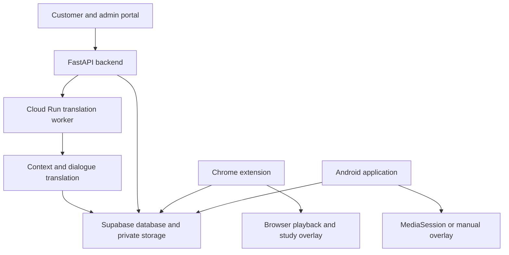

# Subtitle Companion

**A subtitle and language-learning application that connects context-aware translation, synchronized viewing, and study tools across Chrome and Android.**

I am developing Subtitle Companion to help people watch and learn from content when their preferred subtitle language is unavailable, and to make useful dialogue easier to revisit without repeatedly switching between a video player, translator, and notebook.

| At a glance | |
| --- | --- |
| My role | Project owner and developer across the Python backend, browser extension, Android client, and cloud delivery workflow |
| Stage | Application under active development, with implemented translation, browser, and Android workflows |
| Engineering focus | Timing-safe AI processing, playback synchronization, user-specific access, and background job orchestration |
| This repository | Public technical case study; the full application source remains private |

[Problem and motivation](#problem-and-motivation) · [Architecture](#architecture) · [Core engineering](#core-engineering) · [Technology stack](#technology-stack) · [Verification and limitations](#verification-and-limitations)

## Problem and motivation

Subtitle availability is uneven across titles, languages, regions, and devices. Netflix's own [language-availability guidance](https://help.netflix.com/en/node/101798) documents these constraints, including licensing-related differences. This establishes the availability problem; it does not establish customer demand or a market-size estimate for this project.

The product targets two related needs:

| User need | Product response |
| --- | --- |
| Understand dialogue when a preferred language is unavailable | Translate supported subtitle inputs while retaining their original timing |
| Compare the original and translated dialogue | Display multiple subtitle tracks in an adjustable overlay |
| Learn useful phrases without losing viewing context | Save dialogue, revisit cues, repeat supported playback segments, and use study tools |
| Continue on a different device | Connect browser and Android clients to the same account and authorized subtitle library |

I chose this problem because it combines a practical user workflow with substantial backend and client engineering: a translated sentence is only useful if it belongs to the correct cue, appears at the correct time, and is available to the correct user.

## What the application does

- Processes SRT and timed CSV inputs through a Python translation pipeline.
- Uses episode context, terminology, and focused repair to improve consistency across dialogue.
- Provides browser overlays that follow supported player state, with subtitle offset and display controls.
- Provides an Android overlay with automatic playback synchronization where the other app exposes the required MediaSession information, and a manual fallback otherwise.
- Connects subtitle requests, administrator processing, private storage, and customer-specific access grants.
- Supports study workflows including saved dialogue, vocabulary-related tools, cue repetition, and an AI tutor interface.

### Example user journey

1. A customer requests subtitles through the portal.
2. An administrator prepares an authorized subtitle source and starts translation.
3. The backend validates and translates dialogue, then stores the resulting track.
4. An access grant makes the track available to the intended customer.
5. The customer selects it in Chrome or Android, adjusts synchronization if necessary, and saves useful dialogue for study.

This describes the product workflow, rather than a recorded demo or a claim that every streaming player supports identical controls.

## Architecture

The diagram separates the customer access path from background translation work.

The repository contains Cloud Build configuration for testing, building the container, and deploying the service and worker. The worker path separates long-running translation from the request-facing application. This case study describes that implementation and configuration; it does not certify the current production deployment state.

## Core engineering

### 1. Preserve timing outside the language model

**Decision:** parse and render subtitle structure deterministically, and send cue identifiers and dialogue text to the translation provider.

Subtitles contain both language and timing data. Asking a model to recreate the entire file risks corrupting timestamps, dropping cues, or changing their order. The application keeps timing under local control and validates the correspondence between source and translated dialogue.

**Why it matters:** translation quality and structural correctness are separate concerns. A fluent response must still fit the original subtitle timeline.

### 2. Reuse context and repair selectively

**Decision:** build reusable episode context and terminology, translate in batches, then focus additional checking or repair on flagged dialogue.

Short cues can omit the speaker, subject, or relationship information needed to translate them correctly. The implementation includes source-context caching, translation-memory support, protected-text handling, and quality checks for issues such as references, names, numbers, and formatting.

**Trade-off:** additional context and review can improve consistency but consume tokens and time. Selective escalation aims to concentrate that work where it is useful. No translation-accuracy or cost-reduction percentage is claimed here.

### 3. Model background processing as explicit work

**Decision:** dispatch translation work to a Cloud Run job and retain processing state for administrative progress and recovery workflows.

The worker includes a pause-and-resume path for series processing when authorization needs renewal, preserving completed episodes. This addresses a practical failure mode: a long-running task can outlive the authorization context that started it.

**Why it matters:** process completion, user-session lifetime, and browser lifetime cannot be treated as the same event.

### 4. Adapt synchronization to each platform

**Decision:** use browser playback state in Chrome and Android MediaSession information where available, with explicit offset controls and manual fallback.

The browser cue core normalizes cue data, selects active cues for a playback time, and computes offset-aware playback bounds. Android implements its own overlay and playback integration because it cannot access another application's browser video element.

**Trade-off:** synchronization and seek/repeat behavior depend on the target player and its exposed controls. The system does not assume identical capabilities across platforms.

### 5. Enforce access on the data path

**Decision:** connect authenticated accounts to per-customer subtitle grants, private storage, and database row-level policies.

Customer and operator extension builds have different responsibilities. Hiding a download button is not an authorization mechanism; access is controlled by the server/data layer. A client displaying subtitles necessarily receives readable content, so this design is not presented as DRM or absolute copy protection.

## Technology stack

| Layer | Technology | Responsibility |
| --- | --- | --- |
| Backend | Python, FastAPI, Pydantic, Uvicorn | Request handling, validation, translation orchestration, and administrative workflows |
| AI integration | OpenAI API | Context analysis, dialogue translation, and targeted review |
| Data and identity | Supabase Auth, PostgreSQL, private Storage, row-level policies | Accounts, subtitle metadata, grants, and stored tracks |
| Browser client | JavaScript, HTML/CSS, Chrome Manifest V3 | Playback integration, overlays, account access, and study UI |
| Android client | Kotlin, Android SDK, foreground services, MediaSession | Cross-app overlay, playback coordination, and mobile study workflows |
| Cloud delivery | Docker, Google Cloud Run, Cloud Run Jobs, Cloud Build | Containerized service delivery and background translation |
| Verification tooling | pytest, Ruff, browser smoke/E2E tests, JUnit, Robolectric, Android lint | Backend, browser, and Android checks |

## My contribution

My work spans the product workflow and the implementation boundaries between its components:

- Designing the request-to-translation-to-access-grant lifecycle.
- Developing timing-safe translation, context reuse, quality controls, and progress handling.
- Connecting browser playback and Android overlay behavior to the subtitle library.
- Building customer/admin workflows and study interactions.
- Maintaining automated checks and container/worker delivery configuration.

## Verification and limitations

The private implementation includes tests for subtitle parsing, translation quality routing, series processing, grants, study state, browser playback, and Android behavior. Its delivery configuration includes Python checks, browser checks, and separate Android test/lint/build steps.

These are descriptions of the verification coverage and configuration inspected for this case study. Application tests, paid translation calls, device compatibility, and deployment health were not re-executed as part of publishing this documentation.

Current boundaries and next priorities:

- Player-specific synchronization and study-control behavior need continuing compatibility testing.
- Translation quality needs language-specific evaluation and review; structural checks cannot prove semantic correctness.
- Browser and Android workflows are being refined toward consistent behavior rather than claimed as fully equivalent.
- This showcase does not report independently verified customer, revenue, latency, or translation-quality metrics.

## Reviewing the project

This repository provides the product rationale, architecture, implementation decisions, and current boundaries without distributing the private application or subtitle content. A technical walkthrough and a scoped source-code review can be arranged on request.

[Sunmin Lee — GitHub profile](https://github.com/sunminlee-ucd) · [LinkedIn](https://www.linkedin.com/in/sunmin-dev/)

*Implementation and supporting documentation reviewed on 18 October 2026.*
